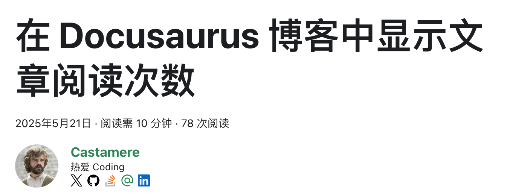

import GitHubRepo from "@site/src/components/GitHubRepo";

# Umami v3 下的文章阅读次数

接[上篇](/blog/PageViewCounter)，Umami 升级到 v3 之后，文章阅读次数的组件就跑不通了。这次换了个思路：借 Umami 公开的 share 链接拿数据，前端代码里不再放任何密钥，同一套代码兼容 v2 和 v3

<GitHubRepo owner="Casta-mere" repo="Docusaurus-Plugin-Umami" />

<!--truncate-->

## 缘起

最近准备把站点的 Umami 从 v2 升级到 v3。v3 不再支持 MySQL，顺带还要迁到 PostgreSQL。排查兼容性的时候，笔者发现上篇做的阅读次数组件在 v3 下有四处跑不通：

1. 按页面筛选的参数从 `url` 改名成了 `path`。v3 会悄悄丢掉不认识的参数，请求不报错，但每篇文章拿到的都是全站的总量
2. `compare` 只接受 `prev` 和 `yoy`，上篇代码里的 `compare=false` 直接返回 400
3. 返回结构被拍平了，`pageviews.value` 变成了 `pageviews`，形如 `{ pageviews: 54, ..., comparison: {...} }`
4. 登录 token 是用 `hash(APP_SECRET || DATABASE_URL)` 加密的。没有单独设置 `APP_SECRET` 的话，换数据库就等于换了密钥，写死在代码里的 token 立刻失效

前三条改几行代码就能修，第四条才是真正的问题。上篇的做法是从 F12 里抄一个管理员的登录 token，原样写进前端代码。打包之后任何人打开 F12 都能看到这串 token，拿着它就能以管理员身份调用 Umami 的 API。迁移让它失效，反倒算是提了个醒

So 这次干脆换一条不需要密钥的路

## share token

在 Umami 后台的网站设置里开启共享链接 (Share URL) 后，任何人都能打开 `/share/<shareId>` 看到这个网站的统计面板，本站页脚的「数据统计」就是这个链接。既然 share 页面不用登录就能拿到数据，它背后一定有一条不需要密钥的路子

翻了一下 share 页面的实现，流程是两步：

1. `GET /api/share/<shareId>`，公开接口，返回 `websiteId` 和一个 `token`
2. 照常调用 `/api/websites/<websiteId>/stats`，只是不带 `Authorization`，而是把上一步的 token 放进 `x-umami-share-token` header。v3 还要求额外带上 `x-umami-share-context: 1`，否则会被当成在 share 页面之外使用 share token 而拒绝；v2 用不到这个 header，带上也无妨

用 curl 验证一下，shareId 就是 share 链接里 `/share/` 后面的那一段：

```bash title="share token"
HOST=https://umami.castamerego.com
WEBSITE_ID=e993a914-0864-4b88-a53c-75e46dc174d7

# 第一步：用 shareId 换 token，不需要登录
curl -s $HOST/api/share/EplxZVQRe6OkyBt3
# {"websiteId":"e993a914-0864-4b88-a53c-75e46dc174d7","token":"<share-token>"}

# 第二步：带上 share token 查单篇文章的数据，全程没有 Authorization
curl -s "$HOST/api/websites/$WEBSITE_ID/stats?startAt=1727427048000&endAt=$(date +%s000)&url=%2Fblog%2FPageViewCounter&path=%2Fblog%2FPageViewCounter" \
  -H "x-umami-share-token: <share-token>" \
  -H "x-umami-share-context: 1"
# {"pageviews":{"value":60,"prev":0},"visitors":{"value":43,"prev":0},...}
```

上面是 v2 服务器的返回。去掉两个 header 再请求就是 401，可见真正起作用的就是这个 share token

:::important
v2.13 的 `/api/share` 不返回 CORS 头，curl 能通，浏览器里的请求却会被拦下来。v3 对所有 `/api/*` 都返回 `Access-Control-Allow-Origin: *`，所以要在前端用这套方案，服务端得是 v3
:::

## useUmamiStats

把上面的流程封装起来，就是 [Docusaurus-Plugin-Umami](https://github.com/Casta-mere/Docusaurus-Plugin-Umami) v2.0.0 `components/` 下的两个文件：

- `umamiStatsClient.ts`：不依赖 React 的请求层，负责换 token、拼 URL、解析返回
- `useUmamiStats.ts`：React hook，负责缓存和重试

两个文件一起复制到站点里即可，本站放在 `src/components/PageViewCounter/` 下

:::tip
如果你使用的不是 Docusaurus，`umamiStatsClient.ts` 不依赖任何框架，可以直接拿去用
:::

### hook

hook 只有两个参数：

```ts title="src/components/PageViewCounter/useUmamiStats.ts"
export interface UseUmamiStatsOptions {
  // Page paths to count (e.g. ['/blog/post', '/en/blog/post']); omit for the whole site.
  paths?: string[]
  // Cache identity; defaults to the joined paths, or '__site__' without paths.
  cacheKey?: string
}

export interface UmamiStatsResult {
  views: number | null
  error: Error | null
}

export function useUmamiStats(options: UseUmamiStatsOptions = {}): UmamiStatsResult {
  const data = usePluginData(PLUGIN_NAME) as UmamiPluginData | undefined
  // ...
}
```

`paths` 是要统计的页面路径，每个路径单独请求一次再加总，不传就是全站的总量；`cacheKey` 决定缓存用的 key。返回值里 `views` 为 `null` 表示还在加载，`error` 不为空表示失败

`host`、`websiteId`、`shareId` 这些都不用组件传，hook 通过 `usePluginData` 从插件的全局数据里读，配置方法见下文的[集成](#集成)

### 兼容 v2 和 v3

缘起里的前三条都在 `umamiStatsClient.ts` 里处理掉了：

```ts title="src/components/PageViewCounter/umamiStatsClient.ts"
// v2 filters on `url`, v3 filters on `path` and each ignores the other, so a
// per-page request carries both. `compare` is never sent.
export function buildStatsUrl(host: string, websiteId: string, range: StatsRange): string {
  let url = `${host}/api/websites/${websiteId}/stats?startAt=${range.startAt}&endAt=${range.endAt}`
  if (range.path) {
    const encoded = encodeURIComponent(range.path)
    // highlight-next-line
    url += `&url=${encoded}&path=${encoded}`
  }
  return url
}

// v3 answers `{ pageviews: 54 }`, v2 answers `{ pageviews: { value: 54, prev: 0 } }`.
export function readPageviews(data: unknown): number {
  if (typeof data !== 'object' || data === null) return 0
  const pageviews = (data as { pageviews?: unknown }).pageviews
  const value =
    typeof pageviews === 'object' && pageviews !== null
      ? (pageviews as { value?: unknown }).value
      : pageviews
  return typeof value === 'number' && Number.isFinite(value) ? value : 0
}
```

- 筛选参数 `url` 和 `path` 一起发。v2 认 `url`，v3 认 `path`，两边都会忽略自己不认识的那个
- `compare` 干脆不发
- `readPageviews` 两种返回结构都认，解析不出来就当 0

请求头固定带上两个 share header：

```ts title="src/components/PageViewCounter/umamiStatsClient.ts"
export const SHARE_TOKEN_HEADER = 'x-umami-share-token'
export const SHARE_CONTEXT_HEADER = 'x-umami-share-context'

// ...

export async function fetchPageviews(args: FetchPageviewsArgs): Promise<number> {
  const { host, websiteId, token, startAt, endAt, paths, fetchImpl } = args
  const doFetch = resolveFetch(fetchImpl)
  // highlight-start
  const headers = {
    [SHARE_TOKEN_HEADER]: token,
    [SHARE_CONTEXT_HEADER]: '1',
  }
  // highlight-end
  // ...
}
```

某一个路径的请求失败、返回非 2xx 或者解析不出来，都只算这个路径为 0，不会连累其它路径

### 缓存与重试

缓存沿用上篇的思路，多了一层 token：

- share token 存在 sessionStorage，key 是 `umami_share_token_<shareId>`，关掉标签页就没了
- 阅读量存在 localStorage，key 还是上篇的 `umami_views_<key>` 和 `umami_views_<key>_time`。5 分钟内先显示缓存的数，同时照常请求新的
- localStorage 和 sessionStorage 不可用时 (SSR、Safari 无痕模式) 全部静默跳过，缓存只是锦上添花

比较有意思的是重试。share token 本身也是用 `hash(APP_SECRET || DATABASE_URL)` 签名的，服务器一迁移，sessionStorage 里的旧 token 就失效了，每个 stats 请求都是 401，加起来正好是 0。所以拿缓存的 token 得到 0 时，hook 会扔掉它，换一个新 token 再试一次：

```ts title="src/components/PageViewCounter/useUmamiStats.ts"
void (async () => {
  try {
    const cachedToken = safeStorage.get('session', tokenKey)
    const token = cachedToken || (await requestToken())
    if (!token) return
    let result = await loadTotal(token)
    if (cancelled) return

    // A token cached in sessionStorage can be stale (for example the server's
    // signing secret changed), and the failed stats calls then add up to 0.
    // Fetch a fresh token and retry once before trusting (and caching) the 0.
    // highlight-start
    if (result.total === 0 && cachedToken) {
      safeStorage.remove('session', tokenKey)
      const fresh = await requestToken()
      if (!fresh) return
      result = await loadTotal(fresh)
      if (cancelled) return
    }
    // highlight-end

    safeStorage.set('local', viewsKey, String(result.total))
    safeStorage.set('local', timeKey, String(result.endAt))
    publish(result.total, null)
  } catch (error) {
    publish(served, toError(error))
  }
})()
```

真正 0 阅读的页面会多换一次 token，这点代价可以忽略。过程中抛出的错误都会进 `error`，组件拿到 `error` 就什么都不渲染——宁可少一个数字，也不显示一个错的

## 集成

### 配置

插件现在通过选项拿到 Umami 的信息，本站的配置如下：

```js title="docusaurus.config.js"
plugins: [
  // ...
  [
    "./src/plugins/plugin-umami",
    {
      host: "https://umami.castamerego.com",
      websiteId: "e993a914-0864-4b88-a53c-75e46dc174d7",
      shareId: "EplxZVQRe6OkyBt3",
      startAt: 1727427048000,
    },
  ],
  // ...
],
```

| 选项 | 说明 |
|---|---|
| `host` | Umami 的地址 |
| `websiteId` | 网站 id，获取方法见[上篇](/blog/PageViewCounter#umami-获取数据) |
| `shareId` | share 链接里的 id。不填的话 tracker 照常工作，但阅读量组件会直接不显示 |
| `startAt` | 统计的起始时间，毫秒时间戳，对应上篇写死在 URL 里的 `startAt` |

插件在 `contentLoaded` 里把这四个值写进全局数据，hook 再用 `usePluginData` 读出来，地址和 id 从此只在配置里出现一次。其余选项控制的是 tracker 脚本本身，Umami 的部署和插件的安装见 [Docusaurus Umami](/docs/Server/Docusaurus-Umami)

### 组件

本站有三个地方显示阅读量：博客文章头部、文档底部、关于页面里的全站总阅读量。三个组件现在都只剩渲染，以博客用的 `UmamiPageViewCounter` 为例：

```tsx title="src/components/PageViewCounter/UmamiPageViewCounter.tsx"
import { useBlogPost } from "@docusaurus/plugin-content-blog/client";
import useDocusaurusContext from "@docusaurus/useDocusaurusContext";
import React from "react";
import { localePair } from "./localePair";
import { useUmamiStats } from "./useUmamiStats";

export default function UmamiPageViewCounter() {
  const { metadata } = useBlogPost();
  const { permalink } = metadata;
  const { i18n } = useDocusaurusContext();
  const { currentLocale } = i18n;
  // highlight-start
  const { views, error } = useUmamiStats({
    paths: localePair(permalink),
    cacheKey: permalink,
  });

  if (error) return null;
  // highlight-end

  if (views == null)
    return (
      <span className="tailwind flex items-center">
        <span className="inline-block w-12 h-3 bg-gray-50 rounded animate-pulse relative top-[1px]" />
      </span>
    );

  return currentLocale === "en" ? <>{views} views</> : <>{views} 次阅读</>;
}
```

`localePair` 是从上篇的代码里抽出来的，中英文两个路径的数据合并显示：

```ts title="src/components/PageViewCounter/localePair.ts"
// The site serves the same page under two locales (`/x` and `/en/x`), and the
// tracker records them as separate paths. Returns the current permalink first,
// then its twin in the other locale.
export function localePair(permalink: string): [string, string] {
  return permalink.startsWith("/en/")
    ? [permalink, permalink.replace(/^\/en/, "")]
    : [permalink, "/en" + permalink];
}
```

文档用的 `UmamiDocViewCounter` 换成 `useDoc` 拿 permalink，其余一样；全站总量的 `UmamiTotalViewCounter` 直接调用 `useUmamiStats()`，不传 `paths`。swizzle 的位置和上篇完全相同，参考[集成到 Docusaurus](/blog/PageViewCounter#集成到-docusaurus)

效果和之前没有区别：



## 与旧方案对比

| | 上篇 | 本篇 |
|---|---|---|
| 凭证 | 管理员登录 token，写死在前端 | share token，运行时用 shareId 现换 |
| token 泄露的后果 | 拿到就能以管理员身份调用 API | 只能看 share 页面本来就公开的数据 |
| 换数据库 / 换密钥 | token 失效，要重新登录、改代码、重新部署 | 自动换新 token 重试 |
| Umami 版本 | 只认 v2 | 请求和返回都兼容 v2、v3 (浏览器里需要 v3) |
| 地址和 id | 每个组件各写一份 | 只在 `docusaurus.config.js` 里写一次 |
| 缓存 | localStorage，5 分钟 | 同样的 key 和 5 分钟，另用 sessionStorage 存 token |

最大的变化是前端不再有任何密钥：shareId 本来就挂在页脚的公开链接里，share token 也是谁都能现换的。缓存的 key 没变，老读者浏览器里存着的阅读量可以直接沿用
