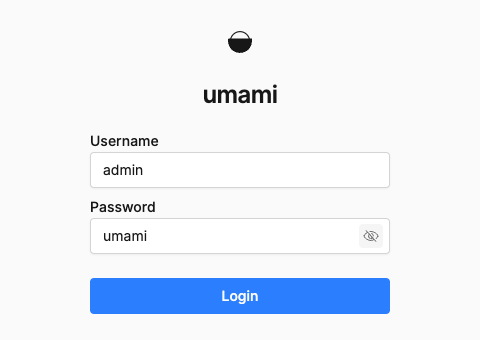
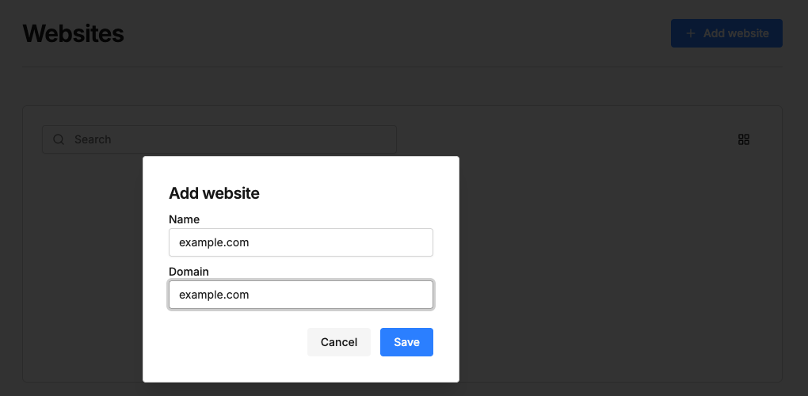
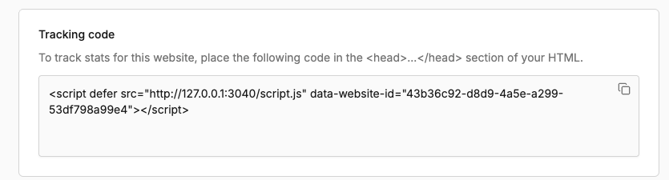

import Tabs from "@theme/Tabs";
import TabItem from "@theme/TabItem";

# Docusaurus Umami

## Umami

[umami] 是一个**开源**、**自托管**的网站分析工具，[这里](https://umami.castamerego.com/share/EplxZVQRe6OkyBt3/castamerego.com)是本站的 umami 数据展示页面。其包括以下功能：

- 网站流量统计
- 网站访问来源、设备、页面、时间、地区、浏览器、操作系统统计
- 自定义操作统计(比如想统计某个 button 的点击次数)
- 各种集成好的数据展示

并且其本质为一个 Next.js 应用，所以可以很方便的集成到现有的 Next.js 项目中。也可以进行二次开发

:::info 版本
本文为 V2.0，基于 Umami v3，用 Docker Compose 部署，数据库为 PostgreSQL。2024 年的旧版（Umami v2 + MySQL，在服务器上手动构建部署）见 [V1](/docs/Server/Docusaurus-Umami-V1)
:::

## 安装（Docker Compose）

Umami v3 只支持 PostgreSQL，官方同时提供了现成的 Docker 镜像。把 PostgreSQL 和 Umami 写进一个 `compose.yml`，服务器上不用装 Node.js，也不用自己编译（1.6 GB 内存的小机器本来也 build 不动 Next.js），表结构由镜像启动时自动迁移。

本站的这几个文件放在仓库的 `scripts/umami-v3/` 下，下文引用的就是它们，服务器上的目录是 `/root/umami-v3/`。

### 准备

需要一台装好 Docker Engine 和 Compose v2 的服务器：

```bash
docker compose version
```

内存方面，笔者的服务器只有 1.6 GB。2026 年 10 月 21 日在这台机器上用 `docker stats` 实测，Umami 容器在 230 到 310 MiB 之间浮动（同一晚的两次读数是 232 MiB 和 311 MiB），PostgreSQL 约 46 到 52 MiB；整机 `free -m` 显示已用 1177 MB，available 287 MB，swap 一点没用到，这台机器上还跑着 MySQL 等其他服务。够用，但不宽裕。第一次启动要跑数据库迁移，从 v2 迁移时还要跑 Prisma，内存会更紧一些，可以加一个 2 GB 的 swap 当保险（可选）：

```bash
fallocate -l 2G /swapfile
chmod 600 /swapfile
mkswap /swapfile
swapon /swapfile
echo '/swapfile none swap sw 0 0' >> /etc/fstab
```

接下来是拉镜像，要用到两个：`postgres:16-alpine` 和 `ghcr.io/umami-software/umami:3.4.0`。服务器在哪里，拉法不一样：

<Tabs groupId="server-region">
  <TabItem value="overseas" label="境外服务器" default>

直接拉就行，或者跳过这一步，`docker compose up -d` 时会自动拉：

```bash
docker pull postgres:16-alpine
docker pull ghcr.io/umami-software/umami:3.4.0
```

  </TabItem>
  <TabItem value="mainland" label="中国大陆服务器">

Docker Hub 连不上，ghcr.io 能连但很慢，笔者实测每个连接只有 43 KB/s 左右。Umami 的镜像有 300 多 MB，要拉一个半小时以上，还会占满 Docker 的并发下载位，排在后面的镜像全部等着。

办法是走镜像站，并且**按 digest 拉**：digest 取自官方，Docker 会拿它校验下载到的内容，镜像站没法偷换。拉下来之后用 `docker tag` 改回官方名字，compose 看到本地已经有同名镜像，就不会再去联网了：

```bash
# Docker 官方镜像：AWS 的 public.ecr.aws 镜像了整个 Docker Official Images
docker pull public.ecr.aws/docker/library/postgres:16-alpine
docker tag public.ecr.aws/docker/library/postgres:16-alpine postgres:16-alpine

# ghcr 镜像：digest 要在能访问 ghcr.io 的机器上查，取 Digest 那一行
docker buildx imagetools inspect ghcr.io/umami-software/umami:3.4.0

docker pull ghcr.m.daocloud.io/umami-software/umami@sha256:<digest>
docker tag ghcr.m.daocloud.io/umami-software/umami@sha256:<digest> ghcr.io/umami-software/umami:3.4.0
```

`<digest>` 换成上一步查到的值。镜像站随时可能变，只要它支持按 digest 拉，换哪一家都行。

:::important
在这样的服务器上不要执行 `docker compose pull`，它会去连 Docker Hub，卡住或者报错。升级镜像时也走同样的流程
:::

  </TabItem>
</Tabs>

### compose.yml

```yaml title="compose.yml" showLineNumbers
services:
  db:
    image: postgres:16-alpine
    environment:
      POSTGRES_DB: umami
      POSTGRES_USER: umami
      POSTGRES_PASSWORD: ${POSTGRES_PASSWORD}
      TZ: UTC
    volumes:
      - umami-db-data:/var/lib/postgresql/data
    healthcheck:
      test: ["CMD-SHELL", "pg_isready -U umami -d umami"]
      interval: 10s
      timeout: 5s
      retries: 5
    restart: unless-stopped
    # highlight-next-line
    mem_limit: 256m
  umami:
    image: ghcr.io/umami-software/umami:3.4.0
    ports:
      # highlight-next-line
      - "127.0.0.1:${UMAMI_PORT:-3030}:3000"
    environment:
      DATABASE_URL: postgresql://umami:${POSTGRES_PASSWORD}@db:5432/umami
      DATABASE_TYPE: postgresql
      APP_SECRET: ${APP_SECRET}
      TWO_FACTOR_ENCRYPTION_KEY: ${TWO_FACTOR_ENCRYPTION_KEY}
      DISABLE_TELEMETRY: "1"
      # highlight-next-line
      NODE_OPTIONS: "--max-old-space-size=384"
    depends_on:
      db:
        condition: service_healthy
    healthcheck:
      test: ["CMD-SHELL", "curl -fsS http://localhost:3000/api/heartbeat || exit 1"]
      interval: 30s
      timeout: 5s
      retries: 5
      start_period: 90s
    restart: unless-stopped
    # highlight-next-line
    mem_limit: 512m
volumes:
  umami-db-data:
```

`mem_limit` 和 `NODE_OPTIONS` 是给容器加的内存上限：`umami` 最多 512 MB，Node 堆限制在 384 MB，`db` 最多 256 MB。小服务器上，容器失控时应该让 Docker 把它杀掉重启，而不是拖着整台机器一起卡死，笔者的服务器在 2026-10-22 就卡死过一次，当时还没有这几行限制

几个地方简单说明一下：

- 镜像 tag 固定为 `3.4.0`，升级时手动改，不用 `latest`
- `db` 没有发布任何端口，只有同一个 compose 网络里的 `umami` 能访问它，数据放在命名卷 `umami-db-data` 里
- `umami` 的端口只绑定在 `127.0.0.1`，外网访问不到，只能走 nginx。Docker 发布的端口会绕开 ufw 之类的主机防火墙，所以别图省事写成 `3030:3000`
- `APP_SECRET` 用来加密登录 token。不设的话 Umami 会退而求其次用 `DATABASE_URL` 派生密钥，数据库一换，所有 token 立刻失效
- `TWO_FACTOR_ENCRYPTION_KEY` 先设好，以后想开两步验证时才不会报 503
- `restart: unless-stopped` 配合 healthcheck，开机自启见[备份与自启动](#备份与自启动)

### .env

密钥放在同目录的 `.env` 里，compose 会自动读取。仓库里只有带占位符的 `.env.example`：

```bash title=".env.example"
POSTGRES_PASSWORD=replace-me
APP_SECRET=replace-me-with-openssl-rand-hex-32
TWO_FACTOR_ENCRYPTION_KEY=replace-me-with-openssl-rand-hex-32
UMAMI_PORT=3030
```

真正的 `.env` 用 `openssl rand` 生成，不要提交到 git：

```bash
cd /root/umami-v3
umask 077
cat > .env <<EOF
POSTGRES_PASSWORD=$(openssl rand -hex 24)
APP_SECRET=$(openssl rand -hex 32)
TWO_FACTOR_ENCRYPTION_KEY=$(openssl rand -hex 32)
UMAMI_PORT=3030
EOF
```

`umask 077` 让生成的文件权限为 600，只有 root 能读。

:::important
`POSTGRES_PASSWORD` 只在数据库第一次初始化时生效。之后改 `.env` 里的这一项，数据库里的密码不会跟着变，Umami 反而连不上了
:::

### 启动

```bash
docker compose up -d
```

第一次启动，Umami 会先把数据库迁移到最新的表结构，需要等一会儿，这段时间 `curl` 会返回 `Empty reply from server`。healthcheck 给了 90 秒的启动宽限，反复执行下面的命令，直到返回 `{"ok":true}`：

```bash
curl -fsS http://127.0.0.1:3030/api/heartbeat
# {"ok":true}
```

`docker compose ps` 里两个服务的状态都变成 `healthy`，就启动成功了。

## 配置 nginx

Umami 只监听在本机的 3030 端口，对外要靠 nginx 反向代理。具体可以参考 [Nginx Reverse Proxy](/docs/Server/NginxReverseProxy) 一篇，如果想要直接使用 https，参考 [SSL](/docs/Server/SSL) 一篇进行配置

配置完成后，nginx 配置文件如下：

```bash showLineNumbers title="/etc/nginx/conf.d/server.conf"
...
server {
  listen 80;
  server_name umami.castamerego.com;

  rewrite ^(.*)$ https://$host$1;

  location / {
    proxy_pass http://localhost:3030;
  }
}

server {
  listen 443 ssl;
  server_name umami.castamerego.com;

  ssl_certificate       conf.d/cert/umami.castamerego.com.cer;
  ssl_certificate_key   conf.d/cert/umami.castamerego.com.key;

  ssl_session_cache     shared:SSL:1m;
  ssl_session_timeout   5m;

  ssl_ciphers           HIGH:!aNULL:!MD5;
  ssl_prefer_server_ciphers on;

  location / {
    proxy_pass http://localhost:3030;
    # highlight-start
    proxy_buffering on;
    proxy_http_version 1.1;
    proxy_ssl_session_reuse off;
    proxy_ssl_server_name on;
    proxy_set_header X-Forwarded-Proto https;
    proxy_set_header X-Real-IP $remote_addr;
    proxy_set_header X-Forwarded-For $proxy_add_x_forwarded_for;
    proxy_set_header X-Forwarded-Host  $host;
    # highlight-end
  }
}
```

域名 `umami.castamerego.com` 被转发到 3030 端口，正好是 compose 里 `127.0.0.1:3030` 绑定的那个。从 V1 升级上来的话，端口没变，nginx 一行都不用改。

高亮的这几行是为了让 Umami 拿到访客的真实信息。经过 nginx 之后，Umami 看到的请求都来自 nginx 自己，不传 `X-Real-IP` 和 `X-Forwarded-For`，就查不到访客的国家，国家一栏会一直是 unknown。v3 的镜像自带 GeoLite2 地理库，不需要另外配置。

## 配置 Umami

### 登录

打开域名，看到登录界面，就说明 Umami 已经跑起来了。初次进入时账号为 admin，密码为 umami



:::important
这是 Umami 公开的默认账号，登录之后请马上修改密码：进入 Settings → Profile（地址 `/settings/profile`），点击 Change password
:::

### 添加网站

在 Websites 页面点击 Add website，填写网站的名称和域名，点 Save



### 跟踪代码

在 Websites 列表里点进刚新建好的网站，打开它的 Settings（地址形如 `/websites/<website-id>/settings`）。在 Tracking code 一栏可以看到一个跟踪代码，将其复制下来备用



截图来自本地临时起的一个 Umami，网站也是随手建的 example.com，所以地址是 `127.0.0.1`，读者看到的会是自己的域名。

### 共享链接

同一个 Settings 页面往下，是 Share 一栏。点击 Add，保持 Overview 勾选，起个名字，点 Save


保存后会生成一个形如 `https://<你的域名>/share/<shareId>` 的链接，其他人可以通过它查看你的网站数据，不需要登录。`/share/` 后面的那一段就是 `shareId`，下一节要用到

:::important
下文的文章阅读次数就是通过这个共享链接读取数据的，所以它必须保持开启，并且勾选 Overview。v3 可以创建多个共享链接，各自开放不同的页面，这里只需要 Overview
:::

## 配置 Docusaurus

### 插件

本站用的是一个自己整理的插件，放在 [Docusaurus-Plugin-Umami](https://github.com/Casta-mere/Docusaurus-Plugin-Umami) 仓库里。使用方法是把 `plugin-umami.js` 复制到 `src/plugins/`，内容如下：

```js title="src/plugins/plugin-umami.js" showLineNumbers
// Author: Casta-mere
// Docusaurus plugin that injects the Umami tracker script and publishes
// { host, websiteId, shareId, startAt } as global data for client components.

const PLUGIN_NAME = 'docusaurus-plugin-umami';

function requireOption(value, name) {
  if (!value) {
    throw new Error(`${PLUGIN_NAME}: option '${name}' is required`);
  }
}

function umamiPlugin(context, options = {}) {
  requireOption(options.host, 'host');
  requireOption(options.websiteId, 'websiteId');

  const host = options.host.replace(/\/+$/, '');
  const {
    websiteId,
    shareId,
    startAt = 0,
    scriptName = 'script.js',
    enableInDev = false,
    autoTrack,
    domains,
    excludeHash,
    excludeSearch,
    doNotTrack,
    tag,
  } = options;

  return {
    name: PLUGIN_NAME,

    contentLoaded({ actions }) {
      actions.setGlobalData({ host, websiteId, shareId: shareId ?? null, startAt });
    },

    injectHtmlTags() {
      // Read at call time so the environment can change between calls (tests).
      if (process.env.NODE_ENV === 'development' && !enableInDev) return;

      const attributes = {
        defer: true,
        src: `${host}/${scriptName}`,
        'data-website-id': websiteId,
      };
      // Attribute names match the keys read by the Umami tracker's config().
      if (autoTrack === false) attributes['data-auto-track'] = 'false';
      if (Array.isArray(domains) && domains.length > 0) attributes['data-domains'] = domains.join(',');
      if (excludeHash) attributes['data-exclude-hash'] = 'true';
      if (excludeSearch) attributes['data-exclude-search'] = 'true';
      if (doNotTrack) attributes['data-do-not-track'] = 'true';
      if (tag) attributes['data-tag'] = tag;

      return {
        headTags: [
          { tagName: 'link', attributes: { rel: 'preconnect', href: `${host}/` } },
          { tagName: 'script', attributes },
        ],
      };
    },
  };
}

module.exports = umamiPlugin;
```

与 V1 相比，不用再改文件本身了，所有配置都通过选项传入。接下来在 `docusaurus.config.js` 中注册插件：

```js title="docusaurus.config.js" showLineNumbers
  ...
  plugins: [
    require.resolve("docusaurus-plugin-image-zoom"),
    // git-add-start
    [
      "./src/plugins/plugin-umami",
      {
        // 换成自己的域名
        // highlight-next-line
        host: "https://umami.castamerego.com",
        // 上一步复制的跟踪代码中的 data-website-id
        // highlight-next-line
        websiteId: "e993a914-0864-4b88-a53c-75e46dc174d7",
        // 共享链接中 /share/ 后面的那一段
        // highlight-next-line
        shareId: "EplxZVQRe6OkyBt3",
        startAt: 1727427048000,
      },
    ],
    // git-add-end
  ],
  ...
```

需要修改的是高亮的三处：`host` 是你的 Umami 域名，`websiteId` 是[跟踪代码](#跟踪代码)里 `data-website-id` 的值，`shareId` 来自[共享链接](#共享链接)。`startAt` 是统计的起点，毫秒时间戳，`0` 表示从头开始，本站填的是第一条数据产生的时刻。

`host` 和 `websiteId` 是必填的，缺了会在启动时直接报错，如 `docusaurus-plugin-umami: option 'host' is required`。完整的选项如下：

| 选项 | 默认值 | 说明 |
| --- | --- | --- |
| `host` | 必填 | Umami 的地址，结尾的 `/` 会被去掉 |
| `websiteId` | 必填 | 网站 ID，即跟踪代码里的 `data-website-id` |
| `shareId` | 无 | 共享链接的 ID，阅读次数组件需要它 |
| `startAt` | `0` | 统计的起点，毫秒时间戳 |
| `scriptName` | `'script.js'` | tracker 脚本的文件名，即 `<host>/<scriptName>` |
| `enableInDev` | `false` | 开发环境（`npm run start`）下是否也注入 tracker |
| `autoTrack` | `true` | 设为 `false` 则不自动统计页面浏览（`data-auto-track`） |
| `domains` | 无 | 只在这些域名下统计，字符串数组（`data-domains`） |
| `excludeHash` | `false` | 统计时忽略 URL 中的 hash（`data-exclude-hash`） |
| `excludeSearch` | `false` | 统计时忽略 URL 中的查询参数（`data-exclude-search`） |
| `doNotTrack` | `false` | 遵循浏览器的 Do Not Track 设置（`data-do-not-track`） |
| `tag` | 无 | 给事件打上的标签（`data-tag`） |

最后重新 build 一遍博客，随便点几个页面，打开网站的 Realtime 页面，应该可以看到数据了

:::important
插件默认只在生产环境下注入 tracker，避免本地调试污染数据。读者在测试时，可以加上 `enableInDev: true`，这样 `npm run start` 时也能看到数据
:::

### 文章阅读量

文章和文档页面上的阅读次数，读取的是上一节开启的共享链接，浏览器里不放任何 token 或密码。请求和返回的格式兼容 Umami v2 和 v3，但要在浏览器里用，服务端必须是 v3：v2.13 的 `/api/share` 不返回 CORS 头，浏览器会拦下请求，v3 对所有 `/api/*` 都返回 `Access-Control-Allow-Origin: *`。具体的原理和组件见 [Umami v3 下的文章阅读次数](/blog/PageViewCounterV2)

## 从 v2（MySQL）迁移

v3 不再支持 MySQL，所以从 V1 的方案升级上来，需要把数据从 MySQL 搬到 PostgreSQL。官方有一份 [Migrate MySQL to PostgreSQL](https://docs.umami.is/docs/guides/migrate-mysql-postgresql) 指南，路径是：先把 MySQL 的表结构升到 v2.19，再在 PostgreSQL 上建一份 v2.19 的空表结构，把数据从 MySQL dump 出来导入，最后启动 v3，由它自己迁移到最新的表结构

笔者照这条路走，把每一步写成了脚本 `scripts/umami-v3/migrate.sh`，并于 2026 年 10 月 21 日在生产环境跑了一遍。脚本里写死了本站的网站 ID 等信息，不能原样拿去用，只是个参考。它按顺序做了这些事：

1. 预检：变量、镜像、MySQL 的迁移状态、磁盘空间都检查一遍，3030 端口不能被占用，所以旧的 v2 要先停掉
2. 在 PostgreSQL 里建 v2.19 的表结构：启动 `db`，用 v2.19 的镜像跑 13 条迁移
3. 清空 PostgreSQL 里种子数据带的默认 `"user"`，真正的 admin 从 MySQL 导入
4. 把 MySQL 的表结构升到 v2.19。这一步之后 v2.13 就再也启动不起来了，是整个流程的**不归路**
5. `mysqldump` 导出数据，在一个事务里通过 `psql` 导入
6. 校验：逐表对比行数，对比 `website_event` 最早和最新的时间、admin 那一行、带单引号的 `page_title`，还有 `user`、`website`、`session`、`website_event` 的整行指纹
7. 启动 v3，它会自己再跑 13 条迁移，`_prisma_migrations` 里共 26 行，等到 heartbeat 返回
8. 对账：用 share token 从 v3 的 API 查全站总浏览量，要与 MySQL 里 `event_type=1` 的条数一致

脚本最后一行输出 `MIGRATION OK`，耗时 250 秒。从停掉 v2 到 v3 对外服务，大约 4 分钟，这期间 tracker 的请求会失败，但对访客没有影响。全站累计浏览量迁移前后都是 56,156，完全一致

:::note
迁移前后有一个数字变了：全站累计的跳出数从 39,501 变成了 39,471，少了 30。数据没有丢，是 v3 改了跳出的算法：只访问了一个页面、但触发过自定义事件的访问，不再算作跳出，本站正好有 30 次
:::

:::tip
验收之后，记得删掉脚本留下的 `migrate-*` 目录，里面有访客数据和 admin 的密码哈希
:::

### 先排练

上面的流程在生产环境只跑了一次，没有出岔子，靠的是之前在本机完整排练了好几遍。思路是把 MySQL 的 dump 拷到本机，用 Docker Desktop 起一个 MySQL 容器灌入，再配上同一份 `compose.yml`，把每一步写成脚本，一直跑到稳定通过，才拿到服务器上执行。排练抓到了三个坑：

- 在 v2.19 的一次性容器里执行 `pnpm check-db` 会报 `Cannot find module 'chalk'`，镜像里没有装它依赖的 `chalk` 和 `semver`。改用 `pnpm update-db` 就行，它执行的是同样的 `prisma migrate deploy`。另外这个版本的 Prisma 每次运行都要从 `binaries.prisma.sh` 下载引擎（约 16 MB），服务器得能访问这个域名
- 服务器上 MySQL 的 `time_zone` 是 SYSTEM（Asia/Shanghai），`mysqldump` 默认的 `--tz-utc` 会把所有 TIMESTAMP 平移 8 小时。排练时故意用默认参数跑了一遍，校验步骤里最早和最新的时间对不上，当场报错。加上 `--skip-tz-utc` 才和 Umami v2 读到的时间一致
- 官方指南用 `sed` 把 dump 里的反引号全部替换成双引号，数据里恰好有反引号的话也会被一起改掉。这里改用 `--compatible=ansi`，让 `mysqldump` 直接用双引号包标识符，这时它查询表空间的语句会报一个无害的 `Error:`，加上 `--no-tablespaces` 就干净了。另外 MySQL 的 dump 用反斜杠转义字符串，导入前要先 `SET standard_conforming_strings = off`，PostgreSQL 才会按同样的规则解析

脚本里还调整了一下顺序：PostgreSQL 一侧的步骤（包括需要联网下载 Prisma 引擎的）全放在 MySQL 升级之前。这样即使中途失败，MySQL 仍然停在 v2.13 能启动的状态，重启旧进程就能恢复。动手之前，别忘了先对 MySQL 做一次全库 `mysqldump`，作为不归路之后的回滚依据

### 与官方指南的差异

官方指南让先清空 PostgreSQL 里的 `_prisma_migrations` 和 `"user"` 两张表，再把 MySQL 的数据整体导入，也就是把 MySQL 那份迁移记录一起搬了过来。笔者没有照做：只清空 `"user"`，`_prisma_migrations` 不动，PostgreSQL 保留自己那 13 行，导出时再用 `--ignore-table` 把 MySQL 的 `_prisma_migrations` 排除在外。这 13 行是 Prisma 在 PostgreSQL 上跑 v2.19 迁移时自己写的，checksum 一定与迁移文件对得上，没必要换成 MySQL 那一份

## 备份与自启动

### 备份

用 `pg_dump` 每天备份一次，保留 14 天：

```bash title="backup.sh"
#!/usr/bin/env bash
set -euo pipefail
umask 077
cd /root/umami-v3
dir=/root/backup/umami
mkdir -p "$dir"
out="$dir/umami-$(date +%F).sql.gz"
tmp="$out.tmp"
# Never leave a partial file behind; the dated file only appears after a verified dump.
trap 'rm -f "$tmp"' EXIT
docker compose exec -T db pg_dump -U umami umami | gzip > "$tmp"
gzip -t "$tmp"
mv "$tmp" "$out"
find "$dir" -name 'umami-*.sql.gz' -mtime +14 -delete
```

dump 先写进 `.tmp` 文件，`gzip -t` 校验通过之后才改成带日期的正式名字。这样 `pg_dump` 中途失败不会留下一个残缺却像备份的文件，失败的重跑也动不了已有的好备份。同一天重跑成功的话，当天的文件会被原子地替换成新的。`umask 077` 则让备份只有 root 能读，里面有访客数据和 admin 的密码哈希

把它加到 root 的 crontab 里，每天凌晨 4 点跑（错开 acme.sh 在 3:30 的证书续期）：

```bash
mkdir -p /root/backup/umami
chmod 755 /root/umami-v3/backup.sh
(crontab -l 2>/dev/null; echo '0 4 * * * /root/umami-v3/backup.sh >> /root/backup/umami/backup.log 2>&1') | crontab -
```

`mkdir` 不能省，cron 命令里的日志重定向发生在脚本启动之前，目录不存在就根本跑不起来。

笔者在服务器上装好之后验证了一遍：

- crontab 里是 `0 4 * * * /root/umami-v3/backup.sh >> /root/backup/umami/backup.log 2>&1`，原来的几行（`steam.py` 和 acme.sh 的）原样保留
- 手动跑一次 `backup.sh`，生成了 6.27 MB 的 `umami-2026-10-21.sql.gz`，`gzip -t` 通过，权限是 600，目录里没有残留的 `.tmp`
- 故意让 `pg_dump` 失败一次，脚本退出码为 1，目录里没有多出任何文件

dump 是纯文本的 SQL，只能灌进一个**空库**，而且灌的时候只能有 `db` 在运行：`umami` 容器一启动就会建表，之后再灌会报 `relation "..." already exists`。所以恢复要先停掉 `umami`，把库删掉重建，再灌回去：

```bash
cd /root/umami-v3
docker compose stop umami
docker compose exec -T db psql -U umami -d postgres -c 'DROP DATABASE umami WITH (FORCE)' -c 'CREATE DATABASE umami OWNER umami'
gunzip -c /root/backup/umami/umami-<日期>.sql.gz | docker compose exec -T db psql -U umami -d umami -v ON_ERROR_STOP=1 -q -o /dev/null
docker compose start umami
```

:::warning
`DROP DATABASE` 会删掉当前库里的所有数据，执行之前先确认备份文件是好的。这套「停服务、删库重建、灌回」的流程，笔者在本地的 `postgres:16-alpine` 上验证过，在 Umami 自己的库上没有真的跑过
:::

备份和数据库在同一块盘上，最好再用 `scp` 或 `rsync` 拉一份到别的机器

### 自启动

`docker.service` 本身是开机自启的，compose 里每个服务都写了 `restart: unless-stopped`，Docker 守护进程起来之后，容器会自己跟着起来，不需要额外写 systemd 的 unit。

测试的办法是重启 Docker，不用真的重启整台机器：

```bash
systemctl restart docker
sleep 90
docker compose -f /root/umami-v3/compose.yml ps
curl -s -o /dev/null -w "%{http_code}\n" http://127.0.0.1:3030/api/heartbeat
```

两个服务都变回 `healthy`，heartbeat 返回 `200`，就说明自启动没问题。笔者在服务器上实测的结果是：重启 Docker 之后，`db` 约 16 秒变成 `healthy`，`umami` 约 60 秒，公网的 `https://umami.castamerego.com/api/heartbeat` 约 66 秒返回 `200`，所以 `sleep 90` 够用。

:::warning
`systemctl restart docker` 会重启这台主机上**所有**的容器，不只是 Umami，同一台机器上的其他服务也会中断一分钟左右，要挑一个没人用的时间来测
:::

:::tip
`unless-stopped` 的意思是：手动 `docker compose stop` 过的容器，重启 Docker 之后不会再起来，只有意外退出和宿主机重启才会自动拉起。
:::

## FAQ

### 升级后阅读量变成 0 / 全站总数

如果用的是[上一篇](/blog/PageViewCounter)的阅读次数组件，升到 v3 之后会发现要么全是 0，要么每篇文章显示的都是全站总数。这是 v2 和 v3 的接口不一样了：

- 按页面过滤的参数从 `url` 改名为 `path`。v3 会悄悄丢掉不认识的参数，请求不报错，但每篇文章拿到的都是全站的总量
- `compare` 只接受 `prev` 和 `yoy`，原来的 `compare=false` 会直接返回 400，组件把错误吞掉，就显示成 0
- 返回结构被拍平了，`pageviews.value` 变成了 `pageviews`，形如 `{"pageviews":54,"visitors":51,...}`
- 写死在前端代码里的管理员 token 失效了。token 是用 `APP_SECRET`（没设的话是 `DATABASE_URL`）加密的，换数据库就等于换了密钥

前三条改几行代码就能修，第四条需要换个思路：不再用管理员 token，改用共享链接换来的 share token。[共享链接](#共享链接)开启之后，可以用 curl 验证一下：

```bash
HOST=https://umami.castamerego.com
WEBSITE_ID=e993a914-0864-4b88-a53c-75e46dc174d7

# 用 shareId 换 token，不需要登录，返回里有 websiteId 和 token
curl -s $HOST/api/share/EplxZVQRe6OkyBt3

# 带上 share token 查某一篇文章，v3 要求同时带 x-umami-share-context
curl -s "$HOST/api/websites/$WEBSITE_ID/stats?startAt=0&endAt=$(date +%s000)&path=%2Fblog%2FPageViewCounterV2" \
  -H "x-umami-share-token: <share-token>" \
  -H "x-umami-share-context: 1"
# {"pageviews":54,"visitors":51,...}
```

插件里的 `useUmamiStats` 就是把这个流程封装好了。请求和返回的格式 v2、v3 都兼容，不过放进浏览器里用，需要服务端是 v3（v2.13 的 `/api/share` 没有 CORS 头），见 [Umami v3 下的文章阅读次数](/blog/PageViewCounterV2)

### 获取不到国家(一直是 unknown)

经过 nginx 反向代理之后，Umami 看到的请求都来自 nginx，需要把访客的真实 IP 传下去才能查到国家。在 [配置 nginx](#配置-nginx) 一节里，umami 的 `location` 中高亮的那几行就是答案，加上之后重载 nginx 即可

[umami]: https://umami.is/
